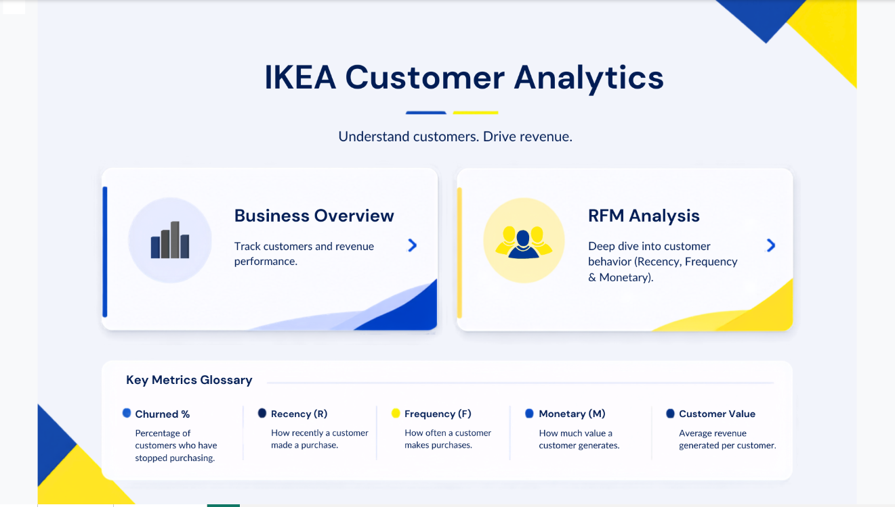
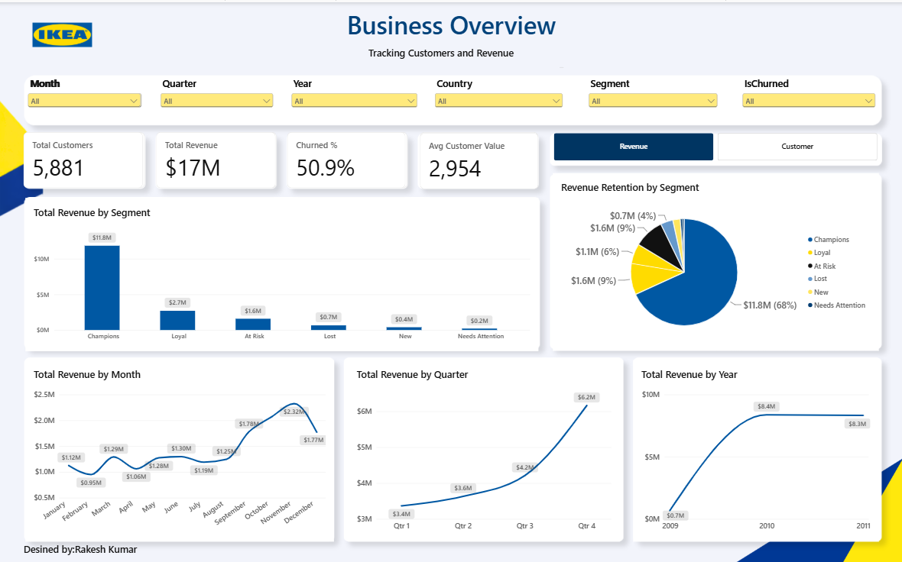
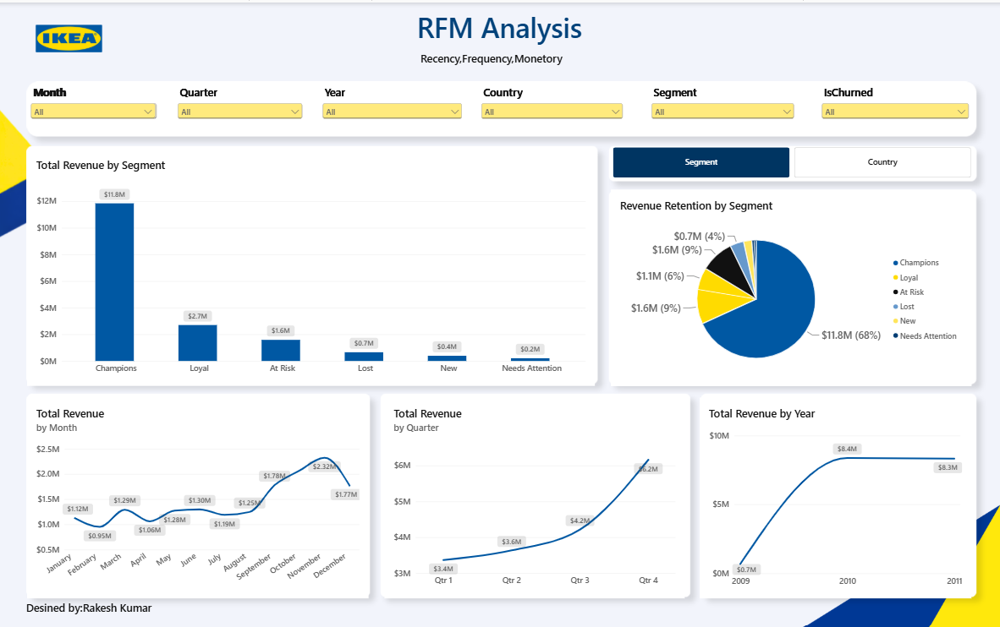

# 🛒 IKEA Customer Analytics & RFM Segmentation

## 📌 Project Overview

This project focuses on analyzing customer purchasing behavior and business performance using retail transaction data. The main objective is to identify valuable customers, understand customer purchasing patterns, and find customers who are at risk of leaving.

Using **SQL, Python (Pandas), and Power BI**, I worked on an end-to-end customer analytics project involving 1M+ retail transactions from December 2009 to December 2011.

The project uses **RFM (Recency, Frequency, Monetary) Analysis** to segment customers based on their purchasing behavior. An interactive Power BI dashboard was developed to present important business insights through KPIs, charts, filters, and visualizations.

## 🎯 Project Objectives

- Analyze customer purchasing behavior.
- Identify high-value customers and their revenue contribution.
- Segment customers using RFM analysis.
- Identify customers who have not purchased in the last 90 days.
- Analyze revenue performance across customer segments.
- Understand monthly, quarterly, and yearly revenue trends.
- Build an interactive dashboard to support business decision-making.

## 🛠️ Tools & Technologies

| Tools | Purpose |
|---|---|
| SQL | Data cleaning, preparation, and validation |
| Python (Pandas) | Data analysis and RFM segmentation |
| Power BI | Interactive dashboard development |
| DAX | Calculated measures and business KPIs |
| Power Query | Data transformation |

## ⚙️ Project Workflow

### 1. Data Cleaning & Preparation (SQL)

- Checked the dataset for missing and duplicate values.
- Cleaned and prepared the transaction data.
- Performed data validation to maintain accuracy.
- Prepared the data for further analysis.

### 2. Customer Analysis (Python)

Used Python and Pandas to analyze customer purchasing behavior through RFM analysis.

**RFM Analysis:**

- **Recency:** How recently a customer made a purchase.
- **Frequency:** How frequently a customer purchased.
- **Monetary:** How much money a customer spent.

Based on these three factors, customers were classified into different segments, including:

- Champions
- Loyal Customers
- At Risk
- Lost Customers
- New Customers
- Needs Attention

Also implemented a 90-day churn flag to identify inactive customers.

### 3. Dashboard Development (Power BI)

Developed an interactive dashboard consisting of three pages:

**Page 1: IKEA Customer Analytics**
- Project introduction and overview.
- Navigation to Business Overview and RFM Analysis.
- Key metrics glossary.

**Page 2: Business Overview**
- Total Customers
- Total Revenue
- Customer Churn Percentage
- Average Customer Value
- Revenue by Customer Segment
- Monthly, Quarterly, and Yearly Revenue Trends
- Revenue Contribution by Segment

**Page 3: RFM Analysis**
- Revenue by Customer Segment.
- Customer segment performance.
- Revenue distribution across segments.
- Monthly, quarterly, and yearly trends.
- Interactive filters for Month, Quarter, Year, Country, Segment, and Churn Status.

## 📊 Key Business Insights

- 🏆 **Champions:** Contributed approximately $11.8M, representing around 68% of total revenue.
- ⚠️ **Customer Churn:** Approximately 50.9% of customers had not purchased within the last 90 days.
- 💰 **At-Risk Customers:** Approximately $1.6M in revenue was associated with At-Risk customers, highlighting a potential retention opportunity.
- 📈 **Revenue Seasonality:** Q4 generated significantly higher revenue than Q1, indicating seasonal purchasing patterns.

## 💡 Key Learnings

Through this project, I gained practical experience in:

- Data cleaning and validation using SQL.
- Data analysis using Python and Pandas.
- Implementing RFM customer segmentation.
- Identifying customer churn and retention opportunities.
- Creating KPIs and measures using DAX.
- Developing interactive dashboards in Power BI.
- Using slicers, bookmarks, and dashboard navigation.
- Converting raw data into meaningful business insights.

## 📁 Project Structure

```text
IKEA-Customer-Analytics/
│
├── SQL/
│   └── SQL Queries
│
├── Python/
│   └── RFM Analysis Notebook
│
├── PowerBI/
│   └── IKEA Customer Analytics.pbix
│
├── Dashboard-Screenshots/
│   ├── Customer Analytics.png
│   ├── Business Overview.png
│   └── RFM Analysis.png
│
└── README.md
```

## 🖼️ Dashboard Preview

### 1. Customer Analytics


### 2. Business Overview


### 3. RFM Analysis


## 🙏 Credits

This is a guided learning project developed by following the tutorial by **Mansi Goel**. I recreated this project to gain practical experience in SQL, Python, customer analytics, RFM segmentation, and Power BI dashboard development.

## 🚀 Conclusion

This project helped me understand how businesses can use customer data to identify valuable customers, recognize potential churn, analyze revenue patterns, and discover opportunities to improve customer retention.

It also strengthened my practical understanding of the end-to-end data analytics process, from data cleaning and analysis to interactive dashboard development.

---

**Thank you for visiting my project!**

I am continuously learning and building projects to improve my skills in Data Analytics.

⭐ If you find this project useful, feel free to explore the repository!

